# ER v2（Cohabit / Django + PostgreSQL）

> 状态：已批准 / 冻结（2026-11-15；M1 按此实现）。本文是 `docs/03-数据字典与问卷.md` 的关系视图，不替代 03 的字段级定义；字段冲突以 03 为准，状态流转以 `docs/02-组寝状态机.md` 为准。
>
> 与旧图 `er-diagram.png` 的差异集中在：UID 10 位数字、`Room.gender`、容量 2/4/6、`Profile.prompts/red_lines_confirmed`、`InviteCode`、`RoomMember.ARCHIVED`、`ConnectionRequest` 新时间字段/关闭原因、`Notification.title`、`RoomTransfer.decided_at`、`TimeWindow` 按学院唯一；不使用 `User.date_joined`、不使用 `RoomMember.joined_at`。

---

## 1. 关系总览

```mermaid
erDiagram
    User ||--o| ContactInfo : "1:1 contact"
    User ||--o| Profile : "1:1 profile"
    User ||--o{ InviteCode : "created_by (nullable)"
    User ||--o{ Room : "owner"
    User ||--o{ RoomMember : "member"
    User ||--o{ RoomTransfer : "from_owner"
    User ||--o{ RoomTransfer : "to_member"
    User ||--o{ ConnectionRequest : "initiator"
    User ||--o{ ConnectionRequest : "target"
    User ||--o{ Notification : "receives"
    User ||--o{ Report : "reporter"
    User ||--o{ Report : "handled_by (nullable)"
    User ||--o{ AuditLog : "actor (nullable)"
    User ||--o{ Block : "blocker"
    User ||--o{ Block : "blocked"
    Room ||--o{ RoomMember : "has"
    Room ||--o{ RoomTransfer : "has"
    Room o|--o{ ConnectionRequest : "room (nullable)"
    TimeWindow }o--|| College : "by college"

    User {
        bigint id PK
        varchar uid UK "10 digits"
        varchar email UK
        varchar nickname
        varchar gender "MALE/FEMALE"
        smallint grade "1-5"
        varchar college
        varchar major
        varchar role "STUDENT/ADMIN"
        varchar status "ACTIVE/DISABLED"
        boolean is_staff
        boolean is_active
        datetime last_login
        datetime created_at
        datetime updated_at
    }

    ContactInfo {
        bigint id PK
        bigint user_id FK "unique"
        varchar qq "nullable"
        varchar wechat "nullable"
        varchar phone "nullable"
        boolean show_qq
        boolean show_wechat
        boolean show_phone
        datetime created_at
        datetime updated_at
    }

    InviteCode {
        bigint id PK
        varchar code UK "8-12, no 0/O/1/I"
        varchar note
        smallint max_uses "0=unlimited"
        smallint used_count
        datetime expires_at "nullable"
        boolean is_active
        bigint created_by_id FK "nullable"
        datetime created_at
        datetime updated_at
    }

    Profile {
        bigint id PK
        bigint user_id FK "unique"
        json hard_answers "11 keys"
        json soft_answers "6 keys, 1-5"
        json red_lines "0-9 ids"
        boolean red_lines_confirmed
        json tags "0-8"
        json prompts "0-3"
        json dims "server-computed"
        smallint completeness "0-100"
        varchar questionnaire_version "v1"
        datetime created_at
        datetime updated_at
    }

    Room {
        bigint id PK
        varchar code UK "9 digits"
        varchar title
        bigint owner_id FK
        smallint capacity "2/4/6"
        smallint member_count
        varchar gender "snapshot"
        varchar college "snapshot"
        varchar major
        json tags "0-8"
        varchar status "RECRUITING/FULL/LOCKED/ARCHIVED/DISSOLVED"
        datetime archived_at "nullable"
        datetime dissolved_at "nullable"
        datetime created_at
        datetime updated_at
    }

    RoomMember {
        bigint id PK
        bigint room_id FK
        bigint user_id FK
        varchar role "OWNER/MEMBER"
        varchar status "ACTIVE/LEFT/REMOVED/ARCHIVED"
        datetime left_at "nullable"
        varchar reason
        datetime created_at
        datetime updated_at
    }

    RoomTransfer {
        bigint id PK
        bigint room_id FK
        bigint from_owner_id FK
        bigint to_member_id FK
        varchar status "PENDING/ACCEPTED/DECLINED/CANCELLED/EXPIRED"
        datetime expires_at "+24h"
        datetime decided_at "nullable"
        datetime created_at
        datetime updated_at
    }

    ConnectionRequest {
        bigint id PK
        varchar type "INVITE/APPLY"
        bigint initiator_id FK
        bigint target_id FK
        bigint room_id FK "nullable"
        varchar status "PENDING/CONTACT_SHARED/CONFIRMING/CONFIRMED/DECLINED/CANCELLED/EXPIRED"
        varchar message
        smallint capacity_pref "2/4/6, nullable"
        datetime contact_shared_at "nullable"
        datetime initiator_confirm_at "nullable"
        datetime target_confirm_at "nullable"
        datetime expires_at
        bigint closed_by_id FK "nullable"
        varchar close_reason
        int version
        datetime created_at
        datetime updated_at
    }

    Notification {
        bigint id PK
        bigint user_id FK
        varchar type
        varchar title "<=60"
        json payload "no contact"
        datetime read_at "nullable"
        datetime created_at
    }

    TimeWindow {
        bigint id PK
        varchar college UK
        datetime start_at
        datetime end_at
        varchar note
        datetime created_at
        datetime updated_at
    }

    Report {
        bigint id PK
        bigint reporter_id FK
        varchar target_type "USER/ROOM/CONNECTION"
        bigint target_id "polymorphic, no FK"
        varchar reason
        varchar status "OPEN/RESOLVED/DISMISSED"
        bigint handled_by_id FK "nullable"
        datetime created_at
        datetime updated_at
    }

    AuditLog {
        bigint id PK
        bigint actor_id FK "nullable"
        varchar action
        varchar target_type
        bigint target_id "nullable"
        json meta "no contact"
        varchar request_id
        datetime created_at
    }

    Block {
        bigint id PK
        bigint blocker_id FK
        bigint blocked_id FK
        datetime created_at
    }

    College {
        varchar name PK
    }
```

> `College` 不是数据库表，只是为了说明 `TimeWindow.college` 与 `User.college` 的取值域一致；v1 学院是字符串，不做外键，避免学院字典未冻结时阻塞注册。
>
> 2026-11-18 已用 Mermaid CLI 12.2.0 将上述 `erDiagram` 渲染为临时 SVG/PNG 验证通过（未将渲染产物入库）；`College` 在图中仅作值域参考，不对应数据库迁移。

---

## 2. 关系与基数说明

| 关系 | 基数 | 删除/变更行为 | 说明 |
| --- | --- | --- | --- |
| `User — ContactInfo` | 1:1 | `CASCADE` | 联系方式独立表；只有本人和 `ConnectionDetail` 解锁状态返回 |
| `User — Profile` | 1:1 | `CASCADE` | 画像/问卷；注册时创建空 Profile |
| `User — InviteCode.created_by` | 1:N | `SET_NULL` | 管理员创建；邀请码不因创建人注销消失 |
| `User — Room.owner` | 1:N | `PROTECT` | 房间必须有房主；用户逻辑删除，不物理删 |
| `User — RoomMember` | 1:N | `CASCADE` | 一人最多一个 ACTIVE 成员关系 |
| `Room — RoomMember` | 1:N | `CASCADE` | `(room,user)` 只有一条记录；不可回流 |
| `Room — RoomTransfer` | 1:N | `CASCADE` | 同寝同时最多一个 PENDING |
| `User — RoomTransfer.from_owner/to_member` | 1:N | `PROTECT` | 转让历史保留 |
| `User — ConnectionRequest.initiator/target` | 1:N | `CASCADE` | 同向只有一个 OPEN；反向可并存但由服务层消解 |
| `Room — ConnectionRequest.room` | 0..1:N | `SET_NULL` | APPLY 必填；INVITE 人-人为空，房主邀请非空 |
| `User — Notification` | 1:N | `CASCADE` | 站内信；payload 不放联系方式 |
| `User — Report.reporter` | 1:N | `CASCADE` | 举报人 |
| `User — Report.handled_by` | 0..1:N | `SET_NULL` | 管理员处理人 |
| `User — AuditLog.actor` | 0..1:N | `SET_NULL` | cron/系统事件 actor 为空 |
| `User — Block.blocker/blocked` | M:N（自关联） | `CASCADE` | `(blocker,blocked)` 唯一；拉黑后互不可见 |
| `TimeWindow — College` | 1:1（按学院） | 无 FK | 每个学院一条；无记录=关闭 |

---

## 3. 约束与索引（与 03 §1.10 对齐）

### 3.1 唯一约束

| 名称 | 表 | 定义 | 目的 |
| --- | --- | --- | --- |
| `uq_user_uid` | `accounts_user` | `uid` | 对外标识 |
| `uq_user_email` | `accounts_user` | `email` | 登录名 |
| `uq_profile_user` | `profiles_profile` | `user_id` | 1:1 |
| `uq_contact_user` | `accounts_contact_info` | `user_id` | 1:1 |
| `uq_block_pair` | `adminops_block` | `(blocker_id, blocked_id)` | 重复拉黑 |
| `uq_invite_code` | `accounts_invite_code` | `code` | 邀请码 |
| `uq_user_active_room` | `rooms_room_member` | `(user_id)` WHERE `status='ACTIVE'` | 一人一 ACTIVE 寝 |
| `uq_room_active_user` | `rooms_room_member` | `(room_id,user_id)` WHERE `status='ACTIVE'` | 同寝重复 |
| `uq_room_active_owner` | `rooms_room_member` | `(room_id)` WHERE `role='OWNER' AND status='ACTIVE'` | 双房主 |
| `uq_room_pending_transfer` | `rooms_room_transfer` | `(room_id)` WHERE `status='PENDING'` | 同时多笔转让 |
| `uq_open_pair` | `connections_connection_request` | `(initiator_id,target_id)` WHERE `status IN ('PENDING','CONTACT_SHARED','CONFIRMING')` | 同向重复在途 |
| `uq_open_apply_room` | `connections_connection_request` | `(room_id,initiator_id)` WHERE `type='APPLY' AND status IN (...)` | 同人同房重复申请 |
| `uq_open_invite_room_target` | `connections_connection_request` | `(room_id,target_id)` WHERE `type='INVITE' AND room_id IS NOT NULL AND status IN (...)` | 同房对同目标重复邀请 |
| `uq_window_college` | `adminops_time_window` | `college` | 每学院一条 |

> 部分唯一索引依赖 PostgreSQL；SQLite 不支持同样语义，测试必须用 PostgreSQL（见 02 §13.4）。

### 3.2 Check 约束

| 名称 | 表 | 条件 |
| --- | --- | --- |
| `ck_room_capacity` | Room | `capacity IN (2,4,6)` |
| `ck_room_member_count` | Room | `member_count <= capacity` |
| `ck_member_status` | RoomMember | `status IN ('ACTIVE','LEFT','REMOVED','ARCHIVED')` |
| `ck_conn_not_self` | ConnectionRequest | `initiator_id <> target_id` |
| `ck_conn_apply_room` | ConnectionRequest | `type='APPLY' → room_id IS NOT NULL` |
| `ck_conn_capacity_pref` | ConnectionRequest | `capacity_pref IS NULL OR capacity_pref IN (2,4,6)` |
| `ck_conn_capacity_scope` | ConnectionRequest | `type='INVITE' AND room_id IS NULL → capacity_pref NOT NULL`；否则 `capacity_pref IS NULL` |
| `ck_window_range` | TimeWindow | `start_at < end_at` |

> `User.gender` / `User.status` 由 Django `choices` + serializer/服务层校验（03 §1.3.1），03 未要求 DB CheckConstraint；如后续要加，需 03 变更后再补 accounts 迁移。

### 3.3 常用索引

| 索引 | 表 | 列 | 用途 |
| --- | --- | --- | --- |
| `idx_user_match` | User | `(college,gender,status)` | 候选池 |
| `idx_room_square` | Room | `(status,college,gender)` | 广场 |
| `idx_conn_target_status` | ConnectionRequest | `(target_id,status)` | 收件箱 |
| `idx_conn_initiator_status` | ConnectionRequest | `(initiator_id,status)` | 发件箱 |
| `idx_conn_status_expires` | ConnectionRequest | `(status,expires_at)` | 过期 cron |
| `idx_notif_user_created` | Notification | `(user_id,-created_at)` | 通知列表 |
| `idx_report_status` | Report | `(status,created_at)` | Admin 队列 |
| `idx_audit_target` | AuditLog | `(target_type,target_id)` | 追溯 |

---

## 4. 状态与关系不变量

1. **一人一 ACTIVE 寝**：`RoomMember(user_id) WHERE status='ACTIVE'` 部分唯一索引；`ARCHIVED` 不占名额。
2. **一寝一 ACTIVE OWNER**：`Room.owner` 与 `RoomMember(role='OWNER',status='ACTIVE')` 必须在同一事务更新；`RoomMember(room_id) WHERE role='OWNER' AND status='ACTIVE'` 唯一。
3. **非终态寝室的 `member_count` = ACTIVE 成员数**：`RECRUITING/FULL/LOCKED` 必须一致；`ARCHIVED/DISSOLVED` 只读历史。
4. **容量不可变**：`capacity IN (2,4,6)`；成立后不接受修改；学生侧无扩容入口。
5. **同对用户一个 OPEN**：`(initiator,target)` 在 `PENDING/CONTACT_SHARED/CONFIRMING` 唯一；反向由服务层在双方 User 行锁内查询并拒绝/合并。
6. **同房同人一条记录**：`(room,user)` 唯一；`LEFT/REMOVED/ARCHIVED` 不可回 `ACTIVE`（不可回流）。
7. **同寝一个 PENDING 转让**：`RoomTransfer(room_id) WHERE status='PENDING'` 唯一；接受时旧房主先降 `MEMBER`，目标再升 `OWNER`。
8. **请求与寝室强一致**：`CONFIRMED` 必须有房间/成员落库；`room` 为空只允许人-人 `INVITE`。
9. **通知/审计只增不改**：`Notification` 只更新 `read_at`；`AuditLog` 不更新/不删除。
10. **联系方式隔离**：`ContactInfo` 不出现在列表/通知/审计 payload；仅 `GET /api/connections/:id` 在解锁状态返回。

---

## 5. 删除/归档策略

| 对象 | 策略 | 级联 |
| --- | --- | --- |
| User | 逻辑删除 `status=DISABLED,is_active=false`，邮箱匿名化 | 在途请求 `CANCELLED+USER_DISABLED`；房主强制解散；成员 `LEFT` |
| Room | 解散 `DISSOLVED` 或归档 `ARCHIVED`，不物理删 | 成员 `LEFT`/`ARCHIVED`；在途请求关闭；转让 `CANCELLED` |
| RoomMember | 不物理删 | `LEFT/REMOVED/ARCHIVED` 保留历史；不回流 |
| ConnectionRequest | 终态保留 | 供审计；`EXPIRED` 由 cron 写 `close_reason=TIMEOUT` |
| Notification | 定时清理（已读 90 天/未读 180 天） | 用户级 |
| Report | 保留；管理员只改状态/处理人 | 目标 id 不级联 |
| AuditLog | 永久保留，只增不改 | actor `SET_NULL` |
| TimeWindow | 不删除；只能改 `end_at` 提前关窗 | 无级联 |

---

## 6. 与旧 ER 的字段对照

| 旧图字段 | v2 字段 | 处理 |
| --- | --- | --- |
| `User.date_joined` | `User.created_at` | 不单独维护 `date_joined` |
| `Profile.answers` | `Profile.hard_answers` + `soft_answers` | 拆分硬/软指标 |
| `RoomMember.joined_at` | `RoomMember.created_at` | 加入时间即 `created_at` |
| `ConnectionRequest.first_confirm_at` | `initiator_confirm_at` / `target_confirm_at` | 双方分别记录 |
| `ConnectionRequest.second_confirm_at` | 不设 | 第二次确认即成立；用 `updated_at`/审计追溯 |
| `Room.capacity` 2–6 | `capacity IN (2,4,6)` | 只允许 2/4/6 |
| 无 `Room.gender` | `Room.gender` | 创建时快照；同性别硬过滤 |
| 无 `Profile.prompts` | `Profile.prompts` | 6 题，0–3 条 |
| 无 `Profile.red_lines_confirmed` | 新增 | 区分“显式无红线”与“未作答” |
| 无 `InviteCode` | 新增 | 内测白名单 |
| 无 `RoomMember.ARCHIVED` | 新增 | 归档不占一人一寝 |
| `ConnectionRequest.close_reason` 旧枚举 | 增加 `BLOCKED`/`AUTO_CANCELLED`/`FULL`/`LOCKED`/`ROOM_DISSOLVED`/`ARCHIVED`/`USER_DISABLED` | 见 02 §3.4 |
| 无 `Notification.title` | 新增 | 模板生成，≤60 |
| 无 `RoomTransfer.decided_at` | 新增 | 接受/拒绝/取消时间 |

---

## 7. 评审检查

- [ ] 所有表都有 `id/created_at/updated_at`（`Notification`/`AuditLog` 只需 `created_at`，与 03 一致）
- [ ] `Room.owner` 与 `RoomMember(OWNER)` 的同步事务写在 service，不在 signal 里做跨表状态机
- [ ] `ContactInfo` 没有任何列表序列化器引用
- [ ] 部分唯一索引在 PostgreSQL 迁移中创建，测试库为 PostgreSQL
- [ ] `capacity=2` 建寝即 `FULL`，`capacity=4/6` 建寝为 `RECRUITING`
- [ ] `RoomMember.ARCHIVED` 不进入“一人一 ACTIVE 寝”部分索引
- [ ] `ConnectionRequest` 的 `room` 为 `SET_NULL`，不随房间物理删除（房间不物理删）
- [ ] `AuditLog.actor`、`InviteCode.created_by`、`Report.handled_by` 为 `SET_NULL`
- [ ] 旧图 `er-diagram.png` 保留为历史参考，不再作为实现依据
