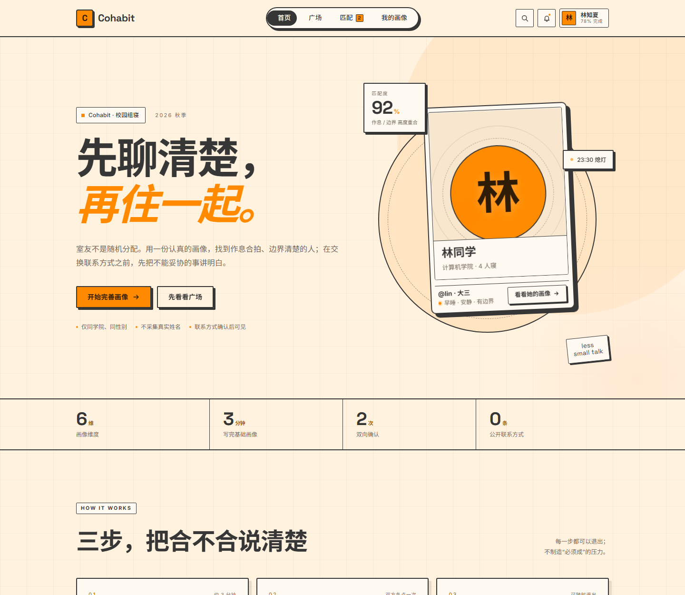
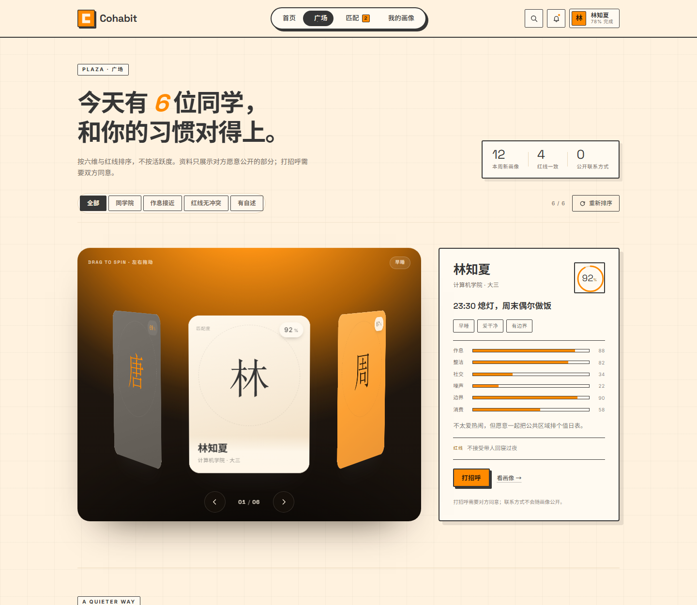
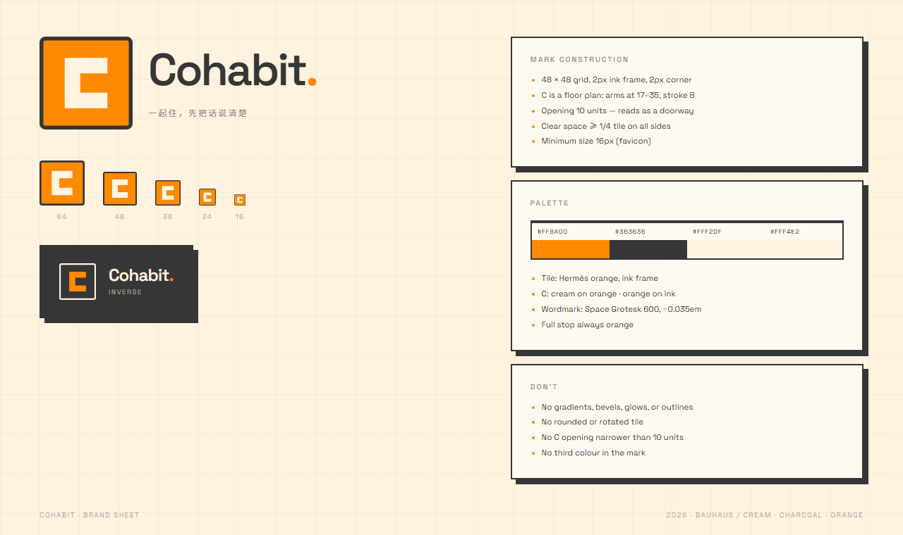

# Cohabit · 校园组寝 UI

以白粉、深灰与爱马仕橙为底，按**包豪斯**语言重做的组寝产品界面：网格纸底、2px 墨线、硬投影、无衬线粗标题与几何色块。这是一个**独立运行的概念项目**：不修改原仓库的代码，只按新的视觉与动效规范重新实现首页、广场、今日匹配和个人画像四个页面。

```bash
npm install
npm run dev        # http://127.0.0.1:5174
npm run build      # 产物在 dist/
npm run typecheck  # vue-tsc --noEmit
```

技术栈：Vue 3.5 + TypeScript + Vite 7 + vue-router。没有引入 UI 框架，样式与动效均为手写；包豪斯覆盖层集中在 `src/styles/bauhaus.css`（用 `#app` 前缀压过 SFC scoped 样式），主页面细化规则在 `HomeView.vue` 的 `<style scoped>` 末尾。

## 预览





## 品牌 / Logo



**概念**：C 是一张俯视的户型图 —— 两侧是厚墙，右侧留一个门洞。橙色是两个人共享的公共空间，米白是墙；`Cohabit.` 末尾的橙色句点像一盏亮着的门牌灯。

- `public/logo-mark.svg`：主标志（橙底 + 米白 C + 墨线），用于浅色底
- `public/logo-mark-inverse.svg`：反白版（墨底 + 橙 C），用于深色底
- `public/favicon.svg`：与主标志同构，16px 下仍可辨认
- `brand/logo-sheet.png`：规范页（结构、尺寸、配色、禁用项）
- `brand/avatar.png`：512×512 社交头像

构造：48×48 网格，2px 墨框、2px 圆角；C 的臂从 17 到 35，笔画 8，门洞 10；四周留白不少于 1/4 格；最小使用尺寸 16px。字形不描边、不加渐变、不旋转；标志里只允许橙、墨、米白三色。字标固定 Space Grotesk 600、字距 −0.035em，句点永远用橙色。

## 设计系统

| Token | 值 | 用途 |
| --- | --- | --- |
| `--paper` | `#fff2df` | 页面底色，白粉（暖奶油） |
| `--paper-raised` | `#fffaf1` | 卡片、浮层 |
| `--paper-deep` | `#f8e7cf` | 分区底色 |
| `--ink` | `#363636` | 正文、深色带 |
| `--line` | `#e9d6b9` | 描边 |
| `--coral` | `#ff8a00` | 主强调色（爱马仕橙） |
| `--coral-dark` | `#a85a00` | 小字号橙，保证对比度 |
| `--amber` | `#ffb45e` | 次强调，用于状态与光晕 |
| `--muted` | `#746a5c` | 次级文字 |

配色取自参考卡：橙 `#FF8A00`、深灰 `#363636`、白粉 `#FFF2DF`；橙色底上用深色字（`#2b1b08`）保证可读性。

字体：标题用 Space Grotesk + Noto Sans SC（`--font-display`，同时接管 `--font-serif`），正文用 Inter + Noto Sans SC，等宽标签用 `--font-mono`。中文没有几何无衬线，粗体中文回落到 Noto Sans SC。

几何：页面是 56px 的墨色网格纸；卡片 2–4px 圆角、2px 墨线描边、`6px 6px 0` 硬投影；按钮与筛选器是直角小圆角，按下时位移 2px 并收起投影。阴影一律是位移硬影（`--hard` / `--hard-sm`），不用模糊投影。

动效曲线：

- `--ease-out` `cubic-bezier(0.16, 1, 0.3, 1)`：所有入场与位移，快进慢停
- `--ease-out-soft` `cubic-bezier(0.22, 1, 0.36, 1)`：骨架流光、渐变
- `--ease-spring` `cubic-bezier(0.34, 1.56, 0.64, 1)`：徽标与磁吸回弹

## 动效与交互

- **首屏骨架**：`index.html` 内联骨架 —— 纸底 56px 网格、品牌方标、药丸导航、标题/正文占位条、画像卡剪影（2px 墨边 + 硬投影）与三块内容占位，统一叠一道斜向流光（`boot-sweep 1.9s`）；Vue 挂载后随 `#app` 一起被替换，`prefers-reduced-motion` 下关闭流光。
- **磁吸按钮** `fx/Magnet.vue` + `fx/MagneticButton.vue`：移植 React Bits 的 Magnet，弹簧参数 `170 / 16 / 1`，`padding 90`、`strength 2.6`、`maxOffset 16`；外层不动，内层跟随指针，离开后回弹。
- **药丸导航** `shell/PillNav.vue`：滑动指示器、标签滚轮、徽标计数；桌面端自动折叠，窄屏由 `App.vue` 显式切成「菜单」按钮 + 全宽抽屉。
- **文字动效**：`fx/ShinyText.vue` 在标题上扫过一道暖色高光；`fx/ScrollFloat.vue` 在 CTA 区做逐字上浮。
- **硬边按钮**：`.btn` 直角 + 2px 墨线 + `6px 6px 0` 硬影；悬停左上位移并加深投影，按下右下位移、投影归零，反馈是“按进纸面”的感觉。按钮上的指针高光与玻璃层已关闭。
- **滚动揭示** `composables/useScrollReveal.ts`：`IntersectionObserver` + `.reveal`，同组元素按 55ms 阶梯延迟；首屏元素立即显示；`prefers-reduced-motion` 下直接落位。
- **个人资料卡** `profile/ProfileCard.vue`：2px 墨线卡片 + 8px 硬影，头像区是纯色橙圆 + 墨色大字 + 虚线圆环；信息条是实心纸色横带，底部是 handle、状态点与直角联系按钮。指针倾斜保留，箔光/眩光/渐变遮罩已移除。
- **聚光灯卡片**：`profile/ProfileCard.vue` 内置低亮度 Spotlight —— 指针位置写入 `--pc-sx/--pc-sy/--pc-spot`，一层暖橙 radial（multiply）叠在卡面上，边缘只留一圈微光，亮度约为主光的 12%。
- **折叠文字** `fx/FoldText.vue`：逐字沿铰链边翻折展开（CSS 3D + IO 触发），支持 top/bottom/left/right 四种铰链与 mount/scroll 两种触发。
- **Dock** `shell/Dock.vue`：macOS 式放大 dock，指针距离决定每个图标的 scale 与上浮，含角标、激活点、悬浮标签；桌面端固定在底部居中。
- **流畅菜单** `shell/FlowingMenu.vue`：全屏菜单，橙色带在行间滑行，带内文字持续流动；由页头菜单按钮或 Dock 的「全部页面」打开。
- **物理吊牌** `profile/SwingTag.vue`：DOM + 弹簧摆（`θ'' = -kθ - cθ'`），按住拖动改变摆角、松手按速度回弹并衰减；织带、金属夹、打孔、编号全部是 CSS 构成，文字保持矢量清晰，比 WebGL 吊牌轻得多。
- **圆形旋转木马** `fx/CircularCarousel.vue`：移植 React Bits 的 CircularCarousel（cylinder 预设），卡片沿圆环排布，透视投影 + 自动缩放适配容器；支持指针拖拽甩动、松手吸附到最近的卡、方向键/回车、悬停暂停自动漂移，点击侧卡把它转到正面。广场用它承载六位同学的画像。

## 入场动画

首次进入 `/` 时，页面先呈现一张居中的米白标题卡（LOGO + 「先聊清楚，再住一起。」），卡片贴在视口中央、四周是更深的米色网格与一枚硬投影。向下滚动时卡片从中间向四周展开到满屏，标题随之上移淡出，随后标题卡整块滑走，露出主页的 hero —— 整个过程由滚动位置驱动，没有独立的“加载页”。

- 组件结构在 `src/views/HomeView.vue` 的 `.entry`，进度由 `useIntro`（`src/composables/useIntro.ts`）向 `App.vue` 广播，用来在动画期间隐藏顶栏
- 滚动映射：`scrollY / innerHeight / 0.85`，再用 0.12 的低通滤波平滑，避免滚轮一格一跳
- 只在满足以下条件时播放：首次进入、桌面宽度 > 900、未开启 `prefers-reduced-motion`；否则直接渲染普通主页（不占位、不闪烁）
- 移动端不播放：小屏上卡片没有足够的展开空间，直接进入主页更干净

## 页面

- `/` 首页：主张、磁吸 CTA、画像卡示例、四格数据、三步流程、画像说明、引用、深色收尾。
- `/plaza` 广场：筛选 pills、骨架加载、深色舞台上的圆形旋转木马，卡片做成吊牌（织带 + 金属夹 + 打孔），拖拽 / 箭头 / 点击切换、右侧奶油色详情（六维条 + 匹配环 + 红线 + 打招呼反馈）。深色舞台让奶油色画像卡成为唯一亮面，突出个人信息。
- `/match` 今日匹配：左侧“你”的画像卡、中间匹配环、右侧一张**可拖拽的物理吊牌**（SpringTag）展示对方；下方三条理由对照。：双卡对照、92% 评分环、三条加权理由、邀请后的状态反馈。
- `/profile` 我的画像：身份卡、完成度、六维、公开内容、只有自己可见、逐项可见性。

数据来自 `src/data/mock.ts`，纯前端演示，没有后端请求。

## 无障碍

语义化标题层级、`aria-current`、`aria-expanded`、`aria-busy`、跳过链接与 `:focus-visible` 焦点环；所有动效在 `prefers-reduced-motion: reduce` 下关闭或退化为静态状态。

## 目录

```
src/
├─ components/
│  ├─ fx/            Magnet / MagneticButton / ShinyText / ScrollFloat / CircularCarousel
│  ├─ profile/       ProfileCard
│  └─ shell/         PillNav
├─ composables/      useScrollReveal
├─ data/             mock.ts
├─ lib/              glassPointer
├─ styles/           main.css（tokens、按钮、卡片、reveal、glass）
├─ views/            HomeView / PlazaView / MatchView / ProfileView
├─ App.vue           页头、页脚、路由过渡
└─ router.ts
```
