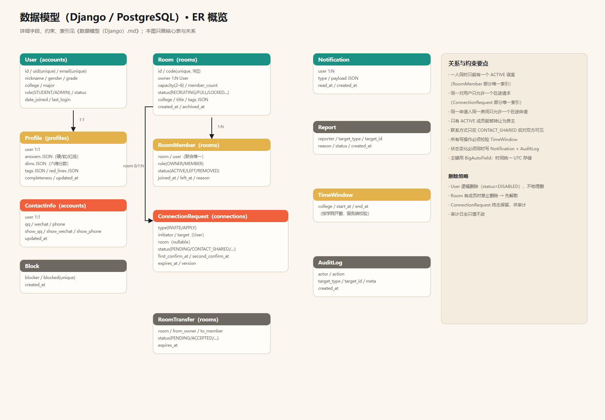

# 数据模型（Django 5 / PostgreSQL）· 方案 A

> 配套：[开发手册（v1）](Cohabit开发手册（v1）.md) ｜ [02-组寝状态机](docs/02-组寝状态机.md) ｜ [ER 图](er-diagram.png)
> 目标：**照着写 models.py 就能跑**——字段、枚举、约束、索引、事务都写清楚；不需要再猜。

---

## 0. 约定（先看，避免后面返工）

| 约定 | 说明 |
| --- | --- |
| App 命名 | **不要**叫 `requests`（会与 Python 第三方库冲突）；组寝请求用 **`connections`** |
| 主键 | `BigAutoField`（全局默认） |
| 时间 | 全部 UTC 存储，前端按本地时区展示；用 `USE_TZ=True` |
| 删除 | 不做物理删除：用户 `status=DISABLED`；寝室先解散；请求终态保留；审计只增不改 |
| 枚举 | 全部用 `models.TextChoices`，值用大写下划线字符串 |
| JSON | 问卷答案/画像维度/标签/通知 payload 用 `JSONField`；字段结构在 `docs/03-数据字典与问卷.md` 固定 |
| 命名 | 表名 `appname_model`；索引/约束 `idx_*` / `uniq_*` / `ck_*` |
| 联系方式 | 单独表 `ContactInfo`，**任何列表接口都不返回**；只在 CONTACT_SHARED 后对请求双方返回 |
| 序列化 | DRF Serializer 显式 `fields`，禁止 `__all__`（防止联系方式泄漏） |



---

## 1. App 与模型清单

| App | 模型 | 职责 |
| --- | --- | --- |
| `accounts` | `User`、`ContactInfo` | 账号、角色、联系方式（私有） |
| `profiles` | `Profile` | 问卷答案、六维分数、标签、红线、完整度 |
| `matching` | （无模型，纯服务） | 匹配算法 `lib/matching.py`；可选缓存表 P1 |
| `rooms` | `Room`、`RoomMember`、`RoomTransfer` | 寝室、成员、转让 |
| `connections` | `ConnectionRequest` | 组寝请求状态机（邀请/申请） |
| `notifications` | `Notification` | 站内消息 |
| `adminops` | `TimeWindow`、`Report`、`Block`、`AuditLog` | 开窗、举报、拉黑、审计 |
| `core` | `BaseModel`（抽象） | 公共字段/异常/分页/权限 |

---

## 2. 模型代码（可直接落地）

### 2.1 `core/models.py`

```python
from django.db import models


class BaseModel(models.Model):
    created_at = models.DateTimeField(auto_now_add=True, db_index=True)
    updated_at = models.DateTimeField(auto_now=True)

    class Meta:
        abstract = True
```

### 2.2 `accounts/models.py`

```python
import secrets

from django.contrib.auth.models import AbstractBaseUser, BaseUserManager, PermissionsMixin
from django.db import models

from core.models import BaseModel


def generate_uid() -> str:
    """10 位数字 UID（随机，非顺序；由 DB 唯一约束兜底）"""
    return f"{secrets.randbelow(10 ** 10):010d}"


class UserManager(BaseUserManager):
    def create_user(self, email, password=None, **extra_fields):
        if not email:
            raise ValueError("email required")
        email = self.normalize_email(email)
        for _ in range(5):
            uid = generate_uid()
            if not User.objects.filter(uid=uid).exists():
                break
        else:
            raise RuntimeError("uid collision")
        user = self.model(email=email, uid=uid, **extra_fields)
        user.set_password(password)
        user.save(using=self._db)
        return user

    def create_superuser(self, email, password=None, **extra_fields):
        extra_fields.setdefault("role", User.Role.ADMIN)
        extra_fields.setdefault("is_staff", True)
        extra_fields.setdefault("is_superuser", True)
        return self.create_user(email, password, **extra_fields)


class User(AbstractBaseUser, PermissionsMixin):
    class Role(models.TextChoices):
        STUDENT = "STUDENT", "学生"
        ADMIN = "ADMIN", "管理员"

    class Status(models.TextChoices):
        ACTIVE = "ACTIVE", "正常"
        DISABLED = "DISABLED", "禁用"

    class Gender(models.TextChoices):
        MALE = "MALE", "男"
        FEMALE = "FEMALE", "女"

    uid = models.CharField("UID", max_length=10, unique=True, editable=False)
    email = models.EmailField("校园邮箱", unique=True, db_index=True)
    nickname = models.CharField("昵称", max_length=20)
    gender = models.CharField("性别", max_length=10, choices=Gender.choices)
    grade = models.PositiveSmallIntegerField("年级", default=1)   # 1=大一
    college = models.CharField("学院", max_length=50, db_index=True)
    major = models.CharField("专业", max_length=50, blank=True, default="")
    role = models.CharField(max_length=10, choices=Role.choices, default=Role.STUDENT)
    status = models.CharField(max_length=10, choices=Status.choices, default=Status.ACTIVE)
    is_staff = models.BooleanField(default=False)   # Django Admin 访问权
    is_active = models.BooleanField(default=True)   # 认证开关
    created_at = models.DateTimeField(auto_now_add=True, db_index=True)
    updated_at = models.DateTimeField(auto_now=True)

    USERNAME_FIELD = "email"
    REQUIRED_FIELDS = ["nickname"]
    objects = UserManager()

    class Meta:
        db_table = "accounts_user"

    def __str__(self):
        return f"{self.nickname}({self.uid})"


class ContactInfo(BaseModel):
    """联系方式单独存：默认不返回，只在请求双方 CONTACT_SHARED 后可见"""
    user = models.OneToOneField(User, on_delete=models.CASCADE, related_name="contact")
    qq = models.CharField(max_length=20, blank=True, default="")
    wechat = models.CharField(max_length=40, blank=True, default="")
    phone = models.CharField(max_length=20, blank=True, default="")
    show_qq = models.BooleanField(default=True)
    show_wechat = models.BooleanField(default=True)
    show_phone = models.BooleanField(default=False)

    class Meta:
        db_table = "accounts_contact_info"
```

### 2.3 `profiles/models.py`

```python
from django.db import models

from accounts.models import User
from core.models import BaseModel


class Profile(BaseModel):
    """一份画像：硬指标/软指标/红线/标签/六维分/完整度"""

    user = models.OneToOneField(User, on_delete=models.CASCADE, related_name="profile")
    hard_answers = models.JSONField(default=dict)   # {"smoke": "no", "snore": "no", ...}
    soft_answers = models.JSONField(default=dict)   # {"sleep": 4, "clean": 5, ...} 1-5
    red_lines = models.JSONField(default=list)      # ["smoke", "snore", "late_return"]
    tags = models.JSONField(default=list)            # ["早睡", "猫派", "社恐但话多"]
    dims = models.JSONField(default=dict)            # {"sleep": 88, "clean": 76, ...}
    completeness = models.PositiveSmallIntegerField(default=0)  # 0-100
    questionnaire_version = models.CharField(max_length=10, default="v1")

    class Meta:
        db_table = "profiles_profile"
```

### 2.4 `rooms/models.py`

```python
from django.db import models
from django.db.models import Q

from accounts.models import User
from core.models import BaseModel


class Room(BaseModel):
    class Status(models.TextChoices):
        RECRUITING = "RECRUITING", "招募中"
        FULL = "FULL", "满员"
        LOCKED = "LOCKED", "已锁定"
        ARCHIVED = "ARCHIVED", "已归档"
        DISSOLVED = "DISSOLVED", "已解散"

    code = models.CharField(max_length=9, unique=True, db_index=True)  # 对外寝室号
    title = models.CharField(max_length=30, blank=True, default="")
    owner = models.ForeignKey(User, on_delete=models.PROTECT, related_name="owned_rooms")
    capacity = models.PositiveSmallIntegerField(default=4)      # 2-6
    member_count = models.PositiveSmallIntegerField(default=1)  # 事务内维护
    college = models.CharField(max_length=50, db_index=True)
    major = models.CharField(max_length=50, blank=True, default="")
    tags = models.JSONField(default=list)
    status = models.CharField(max_length=12, choices=Status.choices, default=Status.RECRUITING)
    archived_at = models.DateTimeField(null=True, blank=True)
    dissolved_at = models.DateTimeField(null=True, blank=True)

    class Meta:
        db_table = "rooms_room"
        indexes = [models.Index(fields=["status", "college"], name="idx_room_status_college")]
        constraints = [
            models.CheckConstraint(check=Q(capacity__gte=2) & Q(capacity__lte=6), name="ck_room_capacity"),
            models.CheckConstraint(check=Q(member_count__lte=models.F("capacity")), name="ck_room_member_count"),
        ]

    @property
    def vacancy(self) -> int:
        return max(0, self.capacity - self.member_count)


class RoomMember(BaseModel):
    class Role(models.TextChoices):
        OWNER = "OWNER", "房主"
        MEMBER = "MEMBER", "成员"

    class Status(models.TextChoices):
        ACTIVE = "ACTIVE", "在寝"
        LEFT = "LEFT", "已退出"
        REMOVED = "REMOVED", "已移除"

    room = models.ForeignKey(Room, on_delete=models.CASCADE, related_name="members")
    user = models.ForeignKey(User, on_delete=models.CASCADE, related_name="room_memberships")
    role = models.CharField(max_length=10, choices=Role.choices, default=Role.MEMBER)
    status = models.CharField(max_length=10, choices=Status.choices, default=Status.ACTIVE)
    left_at = models.DateTimeField(null=True, blank=True)
    reason = models.CharField(max_length=50, blank=True, default="")

    class Meta:
        db_table = "rooms_room_member"
        constraints = [
            # 一人同时只能有一个 ACTIVE 寝室
            models.UniqueConstraint(fields=["user"], condition=Q(status="ACTIVE"),
                                    name="uniq_user_active_room"),
            # 同一寝室不能有重复的 ACTIVE 用户
            models.UniqueConstraint(fields=["room", "user"], condition=Q(status="ACTIVE"),
                                    name="uniq_room_active_user"),
            # 一个寝室只能有一个 ACTIVE 房主
            models.UniqueConstraint(fields=["room"], condition=Q(role="OWNER", status="ACTIVE"),
                                    name="uniq_room_active_owner"),
        ]


class RoomTransfer(BaseModel):
    class Status(models.TextChoices):
        PENDING = "PENDING", "待接受"
        ACCEPTED = "ACCEPTED", "已接受"
        DECLINED = "DECLINED", "已拒绝"
        CANCELLED = "CANCELLED", "已取消"
        EXPIRED = "EXPIRED", "已过期"

    room = models.ForeignKey(Room, on_delete=models.CASCADE, related_name="transfers")
    from_owner = models.ForeignKey(User, on_delete=models.PROTECT, related_name="transfers_sent")
    to_member = models.ForeignKey(User, on_delete=models.PROTECT, related_name="transfers_received")
    status = models.CharField(max_length=10, choices=Status.choices, default=Status.PENDING)
    expires_at = models.DateTimeField()
    decided_at = models.DateTimeField(null=True, blank=True)

    class Meta:
        db_table = "rooms_room_transfer"
        constraints = [
            models.UniqueConstraint(fields=["room"], condition=Q(status="PENDING"),
                                    name="uniq_room_pending_transfer"),
        ]
```

### 2.5 `connections/models.py`（组寝请求：整个产品的核心表）

```python
from django.db import models
from django.db.models import Q

from accounts.models import User
from core.models import BaseModel
from rooms.models import Room

OPEN_STATUSES = ["PENDING", "CONTACT_SHARED", "CONFIRMING"]


class ConnectionRequest(BaseModel):
    class Type(models.TextChoices):
        INVITE = "INVITE", "邀请组寝"
        APPLY = "APPLY", "申请入寝"

    class Status(models.TextChoices):
        PENDING = "PENDING", "待对方确认"
        CONTACT_SHARED = "CONTACT_SHARED", "联系方式互见"
        CONFIRMING = "CONFIRMING", "待二次确认"
        CONFIRMED = "CONFIRMED", "组寝成立"
        DECLINED = "DECLINED", "已拒绝"
        CANCELLED = "CANCELLED", "已取消"
        EXPIRED = "EXPIRED", "已过期"

    class CloseReason(models.TextChoices):
        DECLINED = "DECLINED", "对方拒绝"
        INITIATOR_CANCEL = "INITIATOR_CANCEL", "发起人撤回"
        END_UNDERSTANDING = "END_UNDERSTANDING", "结束了解"
        TIMEOUT = "TIMEOUT", "超时"
        FULL = "FULL", "房间已满"
        LOCKED = "LOCKED", "房间已锁定"
        ROOM_DISSOLVED = "ROOM_DISSOLVED", "房间已解散"
        ARCHIVED = "ARCHIVED", "窗口结束归档"
        USER_DISABLED = "USER_DISABLED", "用户被禁用"
        RATE_LIMITED = "RATE_LIMITED", "触发限频"
        ADMIN = "ADMIN", "管理员关闭"

    type = models.CharField(max_length=10, choices=Type.choices)
    initiator = models.ForeignKey(User, on_delete=models.CASCADE, related_name="connections_sent")
    target = models.ForeignKey(User, on_delete=models.CASCADE, related_name="connections_received")
    room = models.ForeignKey(Room, null=True, blank=True, on_delete=models.SET_NULL,
                             related_name="connection_requests")
    status = models.CharField(max_length=16, choices=Status.choices, default=Status.PENDING)
    message = models.CharField(max_length=200, blank=True, default="")
    capacity_pref = models.PositiveSmallIntegerField(null=True, blank=True)  # 人-人建寝 2/4/6

    contact_shared_at = models.DateTimeField(null=True, blank=True)          # 第一步确认
    initiator_confirm_at = models.DateTimeField(null=True, blank=True)       # 第二步
    target_confirm_at = models.DateTimeField(null=True, blank=True)          # 第二步
    expires_at = models.DateTimeField(db_index=True)
    closed_by = models.ForeignKey(User, null=True, blank=True, on_delete=models.SET_NULL,
                                  related_name="connections_closed")
    close_reason = models.CharField(max_length=20, choices=CloseReason.choices, blank=True, default="")
    version = models.PositiveIntegerField(default=0)  # 乐观锁

    class Meta:
        db_table = "connections_connection_request"
        indexes = [
            models.Index(fields=["target", "status"], name="idx_conn_target_status"),
            models.Index(fields=["initiator", "status"], name="idx_conn_initiator_status"),
            models.Index(fields=["status", "expires_at"], name="idx_conn_status_expires"),
        ]
        constraints = [
            models.CheckConstraint(check=~Q(initiator=models.F("target")), name="ck_conn_not_self"),
            # 同一对用户只允许一个在途请求
            models.UniqueConstraint(
                fields=["initiator", "target"],
                condition=Q(status__in=OPEN_STATUSES),
                name="uniq_open_connection_pair",
            ),
            # 同一申请人对同一房间只允许一个在途申请
            models.UniqueConstraint(
                fields=["room", "initiator"],
                condition=Q(type="APPLY", status__in=OPEN_STATUSES),
                name="uniq_open_apply_room",
            ),
        ]
```

> ⚠️ `UniqueConstraint(condition=...)` 在 PostgreSQL 上是**部分唯一索引**，这正是"重复申请/一脚踏两船"的数据库级保险。SQLite 不支持部分索引语义，所以不要用 SQLite 做正式环境。

### 2.6 `notifications/models.py`

```python
from django.db import models

from accounts.models import User
from core.models import BaseModel


class Notification(BaseModel):
    class Type(models.TextChoices):
        CONNECTION_RECEIVED = "CONNECTION_RECEIVED", "收到组寝请求"
        CONTACT_SHARED = "CONTACT_SHARED", "联系方式互见"
        DECLINED = "DECLINED", "请求被拒绝"
        CONFIRM_PENDING = "CONFIRM_PENDING", "对方已确认"
        CONFIRMED = "CONFIRMED", "组寝成功"
        ROOM_FULL = "ROOM_FULL", "房间已满"
        ROOM_LOCKED = "ROOM_LOCKED", "房间已锁定"
        ROOM_DISSOLVED = "ROOM_DISSOLVED", "房间已解散"
        MEMBER_JOINED = "MEMBER_JOINED", "新成员加入"
        MEMBER_LEFT = "MEMBER_LEFT", "成员退出"
        WINDOW_CLOSING = "WINDOW_CLOSING", "窗口即将关闭"
        SYSTEM = "SYSTEM", "系统通知"

    user = models.ForeignKey(User, on_delete=models.CASCADE, related_name="notifications")
    type = models.CharField(max_length=24, choices=Type.choices)
    title = models.CharField(max_length=60)
    payload = models.JSONField(default=dict)   # {"connection_id": 1, "room_code": "..."}
    read_at = models.DateTimeField(null=True, blank=True, db_index=True)

    class Meta:
        db_table = "notifications_notification"
        indexes = [models.Index(fields=["user", "-created_at"], name="idx_notif_user_created")]
```

### 2.7 `adminops/models.py`

```python
from django.db import models
from django.db.models import Q

from accounts.models import User
from core.models import BaseModel


class TimeWindow(BaseModel):
    """按学院开窗：同学院一条记录，服务端校验"""
    college = models.CharField(max_length=50, unique=True)
    start_at = models.DateTimeField()
    end_at = models.DateTimeField()
    note = models.CharField(max_length=100, blank=True, default="")

    class Meta:
        db_table = "adminops_time_window"


class Report(BaseModel):
    class Target(models.TextChoices):
        USER = "USER", "用户"
        ROOM = "ROOM", "寝室"
        CONNECTION = "CONNECTION", "组寝请求"

    class Status(models.TextChoices):
        OPEN = "OPEN", "待处理"
        RESOLVED = "RESOLVED", "已处理"
        DISMISSED = "DISMISSED", "已驳回"

    reporter = models.ForeignKey(User, on_delete=models.CASCADE, related_name="reports_sent")
    target_type = models.CharField(max_length=12, choices=Target.choices)
    target_id = models.PositiveBigIntegerField()
    reason = models.CharField(max_length=200)
    status = models.CharField(max_length=10, choices=Status.choices, default=Status.OPEN)
    handled_by = models.ForeignKey(User, null=True, blank=True, on_delete=models.SET_NULL,
                                   related_name="reports_handled")

    class Meta:
        db_table = "adminops_report"


class Block(BaseModel):
    blocker = models.ForeignKey(User, on_delete=models.CASCADE, related_name="blocks_sent")
    blocked = models.ForeignKey(User, on_delete=models.CASCADE, related_name="blocks_received")

    class Meta:
        db_table = "adminops_block"
        constraints = [
            models.UniqueConstraint(fields=["blocker", "blocked"], name="uniq_block_pair"),
            models.CheckConstraint(check=~Q(blocker=models.F("blocked")), name="ck_block_not_self"),
        ]


class AuditLog(models.Model):
    """只增不改；管理员/状态机关键操作都写"""
    actor = models.ForeignKey(User, null=True, blank=True, on_delete=models.SET_NULL,
                              related_name="audit_logs")
    action = models.CharField(max_length=50)          # e.g. ROOM_DISSOLVE
    target_type = models.CharField(max_length=20)
    target_id = models.PositiveBigIntegerField(null=True, blank=True)
    meta = models.JSONField(default=dict)
    created_at = models.DateTimeField(auto_now_add=True, db_index=True)

    class Meta:
        db_table = "adminops_audit_log"
```

---

## 3. 约束、索引与并发（开发对照表）

| 约束 | 位置 | 防止的问题 |
| --- | --- | --- |
| `uniq_user_active_room`（部分唯一） | RoomMember | 一人同时在两个寝室 |
| `uniq_room_active_user`（部分唯一） | RoomMember | 同寝室重复成员 |
| `uniq_room_active_owner`（部分唯一） | RoomMember | 两个房主 |
| `uniq_room_pending_transfer`（部分唯一） | RoomTransfer | 同时发起多笔转让 |
| `uniq_open_connection_pair`（部分唯一） | ConnectionRequest | 同对用户重复邀请/申请、邀请与申请叠加 |
| `uniq_open_apply_room`（部分唯一） | ConnectionRequest | 同一人重复申请同一房间 |
| `ck_room_capacity` / `ck_room_member_count` | Room | 人数上限非法、超员 |
| `ck_conn_not_self` | ConnectionRequest | 邀请自己 |
| `uq_room_code` / `user.uid` / `user.email` | Room/User | 编号重复 |

**并发唯一正确写法**（抢最后一个空位 / 双方同时确认）：

```python
from django.db import transaction
from rest_framework.exceptions import ValidationError

@transaction.atomic
def confirm_and_join(request_id: int, user) -> ConnectionRequest:
    req = ConnectionRequest.objects.select_for_update().get(pk=request_id)
    if req.status not in (req.Status.CONTACT_SHARED, req.Status.CONFIRMING):
        raise ValidationError({"code": "REQUEST_CLOSED"})
    # 记录本人确认
    now = timezone.now()
    if user.id == req.initiator_id:
        req.initiator_confirm_at = now
    else:
        req.target_confirm_at = now
    if not (req.initiator_confirm_at and req.target_confirm_at):
        req.status = req.Status.CONFIRMING
        req.expires_at = now + timedelta(hours=48)
        req.save()
        notify_counterpart(req, "CONFIRM_PENDING")
        return req

    # 双方都确认：入寝 / 建寝
    if req.room_id:
        room = Room.objects.select_for_update().get(pk=req.room_id)
        if room.status not in (Room.Status.RECRUITING,) or room.member_count >= room.capacity:
            raise ValidationError({"code": "ROOM_FULL"})
        RoomMember.objects.create(room=room, user=req.initiator if req.type == req.Type.APPLY else req.target,
                                  role=RoomMember.Role.MEMBER, status=RoomMember.Status.ACTIVE)
        room.member_count += 1
        room.status = Room.Status.FULL if room.member_count >= room.capacity else Room.Status.RECRUITING
        room.save()
    else:
        create_room_for_pair(req)   # 人-人邀请：建寝，requester 为房主，capacity=capacity_pref or 4

    req.status = req.Status.CONFIRMED
    req.save()
    cancel_other_open_requests(req)  # 双方其余在途请求自动取消 + 通知
    notify_both(req, "CONFIRMED")
    audit(req)
    return req
```

---

## 4. 枚举值总表（前后端对齐）

| 枚举 | 取值 |
| --- | --- |
| User.role | `STUDENT` / `ADMIN` |
| User.status | `ACTIVE` / `DISABLED` |
| User.gender | `MALE` / `FEMALE` |
| Room.status | `RECRUITING` / `FULL` / `LOCKED` / `ARCHIVED` / `DISSOLVED` |
| RoomMember.role | `OWNER` / `MEMBER` |
| RoomMember.status | `ACTIVE` / `LEFT` / `REMOVED` |
| RoomTransfer.status | `PENDING` / `ACCEPTED` / `DECLINED` / `CANCELLED` / `EXPIRED` |
| ConnectionRequest.type | `INVITE` / `APPLY` |
| ConnectionRequest.status | `PENDING` / `CONTACT_SHARED` / `CONFIRMING` / `CONFIRMED` / `DECLINED` / `CANCELLED` / `EXPIRED` |
| Notification.type | 见 2.6 |
| Report.status | `OPEN` / `RESOLVED` / `DISMISSED` |

---

## 5. 迁移、种子数据与后台

```bash
# 初始化（每天开发前跑）
python manage.py makemigrations
python manage.py migrate

# 演示数据（一条命令重置）
python manage.py seed_demo --reset

# 管理后台
python manage.py createsuperuser
```

**seed_demo 建议生成**（管理命令 `/backend/apps/core/management/commands/seed_demo.py`）：

- 2 个学院 × 20 个学生账号（密码统一 `Demo1234!`，邮箱 `demo001@stu.edu.cn`），画像完整度 100%；
- 6 个寝室：招募中 / 满员 / 锁定 / 已归档各 1–2 个；
- 若干请求：PENDING（待处理）、CONTACT_SHARED（已互见联系方式）、CONFIRMING（待二次确认）；
- 每个学院一条 TimeWindow（开始=昨天，结束=+7 天）；
- 1 个管理员账号（Django Admin）。

**Django Admin 配置要点**（`apps/<app>/admin.py`）：

```python
@admin.register(Room)
class RoomAdmin(admin.ModelAdmin):
    list_display = ("code", "title", "owner", "capacity", "member_count", "status", "college", "created_at")
    list_filter = ("status", "college")
    search_fields = ("code", "title", "owner__nickname", "owner__uid")
    actions = ["force_dissolve"]

    @admin.action(description="强制解散选中寝室")
    def force_dissolve(self, request, queryset):
        for room in queryset:
            dissolve_room(room, by=request.user, reason="ADMIN")
```

> 管理后台**不写 Vue 页面**：用户/寝室/请求/举报/时间窗全部注册进 Django Admin，加 `list_display / list_filter / search_fields / actions` 即可；导出用 `django-import-export`。

---

## 6. 注意事项（踩坑清单）

1. **第 1 天就上自定义 User**（`AUTH_USER_MODEL = "accounts.User"`），后期再换代价巨大。
2. 自定义 User 需要 `UserManager`；`createsuperuser` 用 email，不要再让 Django 问 username。
3. `member_count` 是**冗余字段**，只能由服务层在事务里维护；不要用 `members.count()` 直接展示（性能/一致性）。
4. JSONField 结构一旦上线不要随意改名；新增字段给默认值，并在 `docs/数据字典.md` 记录。
5. 用户删除必须"逻辑删除 + 先处理寝室"；有 ACTIVE 成员时禁止物理删。
6. 联系方式不要放 User 表、不要出现在任何 `ModelSerializer` 列表接口里；单独 `ContactInfo` + 专用接口。
7. 时间统一 `timezone.now()`，禁止 `datetime.now()`。
8. 部分唯一索引在 SQLite 上行为不同 → 本地开发也请用 PostgreSQL（Docker 一条命令）。
9. 迁移文件必须入仓；禁止手改已应用的 migration；改名用 `makemigrations --empty` 写数据迁移。
10. 所有写操作先做**权限**（是否当事人/房主）再做**状态校验**（窗口/状态/空位）。

---

*版本：2026-11-14 ｜ 与状态机 v1.0、开发手册（方案A）配套。*
